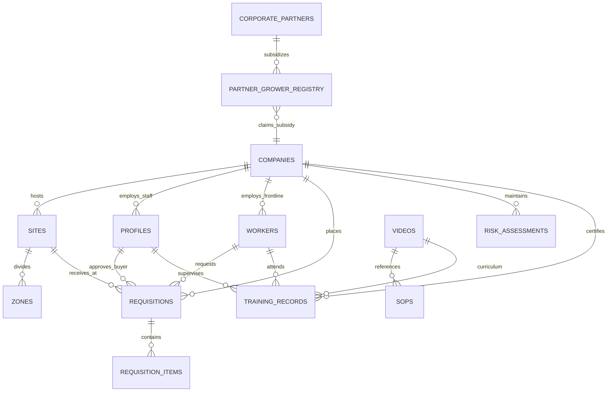

# Simple Solutions Ecosystem: Unified Production Database Architecture
**Document Version:** 2.0.0-PROD-UNIFIED  
**Architect:** `@architect` (System Architecture & Monorepo Infrastructure)  
**Status:** DRAFT SPECIFICATION FOR REVIEW & APPROVAL  
**Scope:** Synthesis of Legacy `the-vault-web` (`SUPABASE_SCHEMA.md`) and `simple-solutions-supply-conduit` (`SUPABASE_SCHEMA1.md`) into a single, high-performance, multi-tenant operational plane.

---

## Executive Summary & Architectural Tenets

The legacy ecosystem suffered from two divergent database architectures across its initial spokes:
1. **The Vault (Legacy):** Heavily denormalized compliance tables with free-text worker attribution, redundant string-array columns (`partner_grower_codes`, `sponsored_crop_packs`), seat-limit licensing debt (`seat_limit = 5`), and recursive RLS subqueries (`company_id IN (SELECT company_id FROM profiles...)`) that triggered Postgres recursion penalties (error `42P17`).
2. **Supply Conduit (Legacy):** Modern tenant modeling (`companies`, `sites`, `zones`, `requesters`), but isolated in a separate database instance with duplicated profile tables (`user_profiles`) and detached worker entities.

### Core Architectural Mandates
* **Single Tenant Boundary (`company_id`):** Every tenant-owned row across all spokes anchors to a single `companies.id` UUID.
* **Worker vs. Profile Identity Split:** Control-plane staff with authentication logins (`profiles` $\rightarrow$ `auth.users.id`) are strictly separated from frontline field labor (`workers`). Frontline workers never consume Supabase Auth seats; they are attributed via cryptographic QR tokens (OHS, training) and E.164 phone numbers (WhatsApp procurement).
* **Zero-Recursion RLS Engine:** Subquery-based RLS policies are eliminated across the entire schema. Tenant tenancy is stamped into the JWT `app_metadata` at token issuance via Supabase `auth.custom_access_token_hook`. Postgres verifies RLS with a single clock-cycle JSON lookup: `((auth.jwt() -> 'app_metadata' ->> 'company_id')::uuid = company_id)`.
* **Offline Outbox Engine:** Field interactions in low-signal orchards or packhouses commit to client-side IndexedDB (Dexie.js) and replay into an idempotent server-side `sync_inbox` table.



---

## 1. Unified Multi-Tenant Foundation (Core / Shared Plane)

### 1.1 `companies` (Tenant Master Entity)
Replaces both legacy `companies` tables. Eliminates seat licensing columns (`seat_limit`), separates Paystack billing references into a structured `billing_metadata` column, and provides explicit linkage to corporate partner export subsidies.

```sql
CREATE TYPE public.billing_tier AS ENUM (
    'bundle',                 -- Full Site Bundle (The Vault + Spray Trace + Conduit + Packhouse Pass)
    'standalone_vault',       -- The Vault (OHS & Training Compliance Core)
    'standalone_conduit',     -- Supply Conduit (WhatsApp Procurement)
    'standalone_spray',       -- Spray Trace V1 (Act 36 Chemical Traceability)
    'standalone_packhouse',   -- Packhouse Pass (Weighbridge & QC Intake)
    'enterprise'              -- Bespoke Custom Workflows & Multi-Site Estates
);

CREATE TABLE public.companies (
    id UUID PRIMARY KEY DEFAULT gen_random_uuid(),
    name TEXT NOT NULL,
    slug TEXT UNIQUE NOT NULL,
    company_code VARCHAR(6) UNIQUE NOT NULL, -- Short prefix for requisitions/barcodes (e.g., 'DV01')
    billing_tier public.billing_tier NOT NULL DEFAULT 'bundle',
    is_active BOOLEAN NOT NULL DEFAULT true,
    currency VARCHAR(3) NOT NULL DEFAULT 'ZAR',
    timezone TEXT NOT NULL DEFAULT 'Africa/Johannesburg',
    
    -- Corporate Partner Subsidy Linkage (Replaces redundant text[] arrays)
    partner_id UUID REFERENCES public.corporate_partners(id) ON DELETE SET NULL,
    is_subsidized BOOLEAN NOT NULL DEFAULT false,
    
    -- Centralized Billing Metadata (Replaces Paystack table bloat)
    billing_metadata JSONB NOT NULL DEFAULT '{
        "provider": "paystack",
        "customer_code": null,
        "subscription_code": null,
        "plan_code": null,
        "billing_email": null,
        "status": "active",
        "next_payment_date": null,
        "billing_interval": "monthly"
    }'::jsonb,
    
    -- Operational Tenancy Settings
    settings JSONB NOT NULL DEFAULT '{
        "require_zone_for_requisitions": false,
        "duplicate_window_days": 7,
        "auto_approve_threshold_zar": 0.00,
        "require_supervisor_signature": true,
        "default_language": "en"
    }'::jsonb,
    
    -- Statutory & Commercial Identity
    vat_number TEXT,
    postal_address TEXT,
    phone TEXT,
    contact_email TEXT,
    company_stamp_url TEXT,
    
    created_at TIMESTAMPTZ NOT NULL DEFAULT timezone('utc'::text, now()),
    updated_at TIMESTAMPTZ NOT NULL DEFAULT timezone('utc'::text, now()),

    CONSTRAINT ck_company_code_format CHECK (company_code ~ '^[A-Z0-9]{2,6}$')
);

CREATE INDEX idx_companies_slug ON public.companies(slug);
CREATE INDEX idx_companies_partner_id ON public.companies(partner_id) WHERE partner_id IS NOT NULL;
```

---

### 1.2 `sites` (Physical Operating Facilities)
Represents discrete physical locations (e.g., Doveton Main Farm, Packhouse Facility, Workshop Yard).

```sql
CREATE TABLE public.sites (
    id UUID PRIMARY KEY DEFAULT gen_random_uuid(),
    company_id UUID NOT NULL REFERENCES public.companies(id) ON DELETE CASCADE,
    name TEXT NOT NULL,
    code VARCHAR(20) NOT NULL, -- e.g., 'MAIN', 'PACK-01'
    location_description TEXT,
    gps_coordinates POINT,     -- PostGIS or standard PostgreSQL geometric point (lon, lat)
    is_active BOOLEAN NOT NULL DEFAULT true,
    created_at TIMESTAMPTZ NOT NULL DEFAULT timezone('utc'::text, now()),
    updated_at TIMESTAMPTZ NOT NULL DEFAULT timezone('utc'::text, now()),

    CONSTRAINT uq_site_company_code UNIQUE (company_id, code)
);

CREATE INDEX idx_sites_company ON public.sites(company_id);
```

---

### 1.3 `zones` (Granular Sub-Areas & Spatial Blocks)
Represents orchard blocks, cold rooms, fleet bays, and intake lines. To guarantee **zero-recursion RLS**, `zones` carries a denormalized `company_id`.

```sql
CREATE TABLE public.zones (
    id UUID PRIMARY KEY DEFAULT gen_random_uuid(),
    company_id UUID NOT NULL REFERENCES public.companies(id) ON DELETE CASCADE,
    site_id UUID NOT NULL REFERENCES public.sites(id) ON DELETE CASCADE,
    name TEXT NOT NULL,          -- e.g., 'Block B-14 (Macadamia)', 'Cold Room 02'
    code VARCHAR(20),            -- e.g., 'B14', 'CR02'
    zone_type TEXT NOT NULL DEFAULT 'orchard' CHECK (zone_type IN ('orchard', 'workshop', 'packhouse', 'storage', 'general')),
    crop_variety TEXT,           -- e.g., 'Beaumont', 'A4', 'Cavendish'
    hectares NUMERIC(8,2),
    is_active BOOLEAN NOT NULL DEFAULT true,
    created_at TIMESTAMPTZ NOT NULL DEFAULT timezone('utc'::text, now()),
    updated_at TIMESTAMPTZ NOT NULL DEFAULT timezone('utc'::text, now()),

    CONSTRAINT uq_zone_site_code UNIQUE (site_id, code)
);

CREATE INDEX idx_zones_company ON public.zones(company_id);
CREATE INDEX idx_zones_site ON public.zones(site_id);
```

---

### 1.4 `profiles` (Authenticated Control-Plane Users)
Unified authenticated user entity representing owners, farm managers, buyers, agronomists, and safety auditors. Anchors directly to `auth.users.id`.

```sql
CREATE TYPE public.user_role AS ENUM (
    'owner',          -- Primary account holder; full billing & administrative authority
    'admin',          -- Estate manager / operational controller
    'farm_manager',   -- Site supervisor / production director
    'buyer',          -- Procurement officer managing PO placement & quotes
    'supervisor',     -- Field supervisor verifying training, pre-starts & requisitions
    'agronomist',     -- Technical compliance & chemical advisor (Spray Trace)
    'auditor',        -- Read-only statutory auditor (SIZA / GLOBALG.A.P. inspection role)
    'viewer'          -- Read-only dashboard viewer
);

CREATE TABLE public.profiles (
    id UUID PRIMARY KEY REFERENCES auth.users(id) ON DELETE CASCADE,
    company_id UUID NOT NULL REFERENCES public.companies(id) ON DELETE RESTRICT,
    email TEXT NOT NULL,
    full_name TEXT NOT NULL,
    role public.user_role NOT NULL DEFAULT 'viewer',
    phone_number VARCHAR(20),
    avatar_url TEXT,
    
    -- Site-Level Scoping: NULL indicates access to all tenant sites
    authorized_site_ids UUID[] DEFAULT NULL,
    
    is_active BOOLEAN NOT NULL DEFAULT true,
    created_at TIMESTAMPTZ NOT NULL DEFAULT timezone('utc'::text, now()),
    updated_at TIMESTAMPTZ NOT NULL DEFAULT timezone('utc'::text, now())
);

CREATE INDEX idx_profiles_company ON public.profiles(company_id);
CREATE INDEX idx_profiles_role ON public.profiles(company_id, role);
```

---

### 1.5 `workers` (Universal Frontline Labor Directory)
Synthesizes legacy `company_employees` (The Vault) and `requesters` (Supply Conduit) into a single frontline labor entity. Implements the **Anti-Per-Seat, Unlimited Frontline Worker Model**.

```sql
CREATE TABLE public.workers (
    id UUID PRIMARY KEY DEFAULT gen_random_uuid(),
    company_id UUID NOT NULL REFERENCES public.companies(id) ON DELETE CASCADE,
    first_name TEXT NOT NULL,
    last_name TEXT NOT NULL,
    employee_number VARCHAR(30),           -- Optional payroll/clock number (e.g., 'EMP-0142')
    id_passport_number TEXT,               -- Statutory identification for SIZA / OHS records
    gender TEXT CHECK (gender IS NULL OR gender IN ('Male', 'Female', 'Other')),
    
    -- Omnichannel Identifiers
    phone_number VARCHAR(20),              -- Normalized E.164 (e.g., '+27821234567') for WhatsApp Procurement
    qr_token TEXT UNIQUE NOT NULL DEFAULT ('WKT-' || gen_random_uuid()::text), -- Physical badge scanning
    
    -- Operational Context
    role_title TEXT NOT NULL,              -- e.g., 'Tractor Driver', 'Spray Applicator', 'Packhouse Sorter'
    default_site_id UUID REFERENCES public.sites(id) ON DELETE SET NULL,
    team_or_orchard TEXT,
    preferred_language VARCHAR(10) NOT NULL DEFAULT 'en', -- 'zu', 'en', 'af', 'xh'
    
    -- Compliance & Statutory Consent Flags
    consent_flags JSONB NOT NULL DEFAULT '{
        "popia_data_processing": true,
        "medical_fitness_on_file": false,
        "hazchem_certified": false
    }'::jsonb,
    
    is_active BOOLEAN NOT NULL DEFAULT true,
    created_at TIMESTAMPTZ NOT NULL DEFAULT timezone('utc'::text, now()),
    updated_at TIMESTAMPTZ NOT NULL DEFAULT timezone('utc'::text, now())
);

-- Indexes for instant webhook lookup and badge verification
CREATE INDEX idx_workers_company ON public.workers(company_id);
CREATE INDEX idx_workers_phone ON public.workers(company_id, phone_number) WHERE phone_number IS NOT NULL;
CREATE INDEX idx_workers_employee_num ON public.workers(company_id, employee_number) WHERE employee_number IS NOT NULL;
CREATE INDEX idx_workers_qr_token ON public.workers(qr_token);
```

---

## 2. Auth & Performance-Optimized RLS Engine

### 2.1 The Supabase Auth Custom Access Token Hook
To eliminate recursive RLS subqueries (e.g., `WHERE company_id IN (SELECT company_id FROM profiles...)`), Supabase Auth runs `auth.custom_access_token_hook` on every token refresh or sign-in. This hook injects `company_id`, `role`, and `site_ids` into the JWT claims (`app_metadata`).

```sql
CREATE OR REPLACE FUNCTION public.custom_access_token_hook(event JSONB)
RETURNS JSONB
LANGUAGE plpgsql
STABLE
SECURITY DEFINER
SET search_path = public
AS $$
DECLARE
    claims JSONB;
    v_company_id UUID;
    v_role TEXT;
    v_site_ids UUID[];
    v_is_active BOOLEAN;
BEGIN
    -- Query profile directly by auth.users.id
    SELECT company_id, role::text, authorized_site_ids, is_active
    INTO v_company_id, v_role, v_site_ids, v_is_active
    FROM public.profiles
    WHERE id = (event->>'user_id')::uuid;

    claims := event->'claims';

    -- Reject deactivated users immediately by stripping app claims
    IF v_is_active IS NOT TRUE OR v_company_id IS NULL THEN
        claims := jsonb_set(claims, '{app_metadata, company_id}', 'null'::jsonb);
        claims := jsonb_set(claims, '{app_metadata, role}', '"unassigned"'::jsonb);
    ELSE
        -- Stamp tenant context into app_metadata
        claims := jsonb_set(claims, '{app_metadata, company_id}', to_jsonb(v_company_id::text));
        claims := jsonb_set(claims, '{app_metadata, role}', to_jsonb(v_role));
        
        IF v_site_ids IS NOT NULL THEN
            claims := jsonb_set(claims, '{app_metadata, site_ids}', to_jsonb(v_site_ids));
        ELSE
            claims := jsonb_set(claims, '{app_metadata, site_ids}', '[]'::jsonb);
        END IF;
    END IF;

    event := jsonb_set(event, '{claims}', claims);
    RETURN event;
END;
$$;

-- Grant execution authority exclusively to Supabase Auth admin service
GRANT EXECUTE ON FUNCTION public.custom_access_token_hook(JSONB) TO supabase_auth_admin;
REVOKE EXECUTE ON FUNCTION public.custom_access_token_hook(JSONB) FROM authenticated, anon, public;
```

---

### 2.2 Standardized Zero-Recursion RLS Formula
All tenant-isolated tables apply identical, single-clock-cycle policies without table joins.

```sql
-- Macro standard expression:
-- ((auth.jwt() -> 'app_metadata' ->> 'company_id')::uuid = company_id)

-- 1. Enable RLS on all operational tables
ALTER TABLE public.companies ENABLE ROW LEVEL SECURITY;
ALTER TABLE public.sites ENABLE ROW LEVEL SECURITY;
ALTER TABLE public.zones ENABLE ROW LEVEL SECURITY;
ALTER TABLE public.profiles ENABLE ROW LEVEL SECURITY;
ALTER TABLE public.workers ENABLE ROW LEVEL SECURITY;

-- 2. Companies Policy: Members view their own company; Owners/Admins update
CREATE POLICY "companies_tenant_isolation" ON public.companies
    FOR SELECT TO authenticated
    USING (id = (auth.jwt() -> 'app_metadata' ->> 'company_id')::uuid);

CREATE POLICY "companies_admin_update" ON public.companies
    FOR UPDATE TO authenticated
    USING (
        id = (auth.jwt() -> 'app_metadata' ->> 'company_id')::uuid 
        AND (auth.jwt() -> 'app_metadata' ->> 'role') IN ('owner', 'admin')
    );

-- 3. Profiles Policy: Tenant members view coworkers; Users update self
CREATE POLICY "profiles_tenant_read" ON public.profiles
    FOR SELECT TO authenticated
    USING (company_id = (auth.jwt() -> 'app_metadata' ->> 'company_id')::uuid);

CREATE POLICY "profiles_self_or_admin_write" ON public.profiles
    FOR UPDATE TO authenticated
    USING (
        company_id = (auth.jwt() -> 'app_metadata' ->> 'company_id')::uuid
        AND (id = auth.uid() OR (auth.jwt() -> 'app_metadata' ->> 'role') IN ('owner', 'admin'))
    );

-- 4. Workers Policy: Full access within tenant
CREATE POLICY "workers_tenant_all" ON public.workers
    FOR ALL TO authenticated
    USING (company_id = (auth.jwt() -> 'app_metadata' ->> 'company_id')::uuid)
    WITH CHECK (company_id = (auth.jwt() -> 'app_metadata' ->> 'company_id')::uuid);

-- 5. Sites & Zones Policy
CREATE POLICY "sites_tenant_all" ON public.sites
    FOR ALL TO authenticated
    USING (company_id = (auth.jwt() -> 'app_metadata' ->> 'company_id')::uuid)
    WITH CHECK (company_id = (auth.jwt() -> 'app_metadata' ->> 'company_id')::uuid);

CREATE POLICY "zones_tenant_all" ON public.zones
    FOR ALL TO authenticated
    USING (company_id = (auth.jwt() -> 'app_metadata' ->> 'company_id')::uuid)
    WITH CHECK (company_id = (auth.jwt() -> 'app_metadata' ->> 'company_id')::uuid);
```

---

## 3. Spoke 1: The Vault (OHS, Training & Statutory Compliance)

### 3.1 Media & Content Catalog (`videos`, `sops`)
The Vault maintains a global curriculum library alongside tenant-specific proprietary standard operating procedures.

```sql
CREATE TABLE public.videos (
    id TEXT PRIMARY KEY,                 -- Video slug (e.g., 'chem-handling-act36')
    company_id UUID REFERENCES public.companies(id) ON DELETE CASCADE, -- NULL = Global Library
    title TEXT NOT NULL,
    category TEXT NOT NULL DEFAULT 'Agriculture',
    sub_tag TEXT,
    language TEXT NOT NULL DEFAULT 'English',
    total_seconds INTEGER NOT NULL,
    thumbnail_url TEXT,
    description TEXT,
    objectives JSONB NOT NULL DEFAULT '[]'::jsonb,
    questions JSONB NOT NULL DEFAULT '[]'::jsonb,
    curriculum_slug TEXT,
    streams JSONB NOT NULL DEFAULT '{}'::jsonb, -- Vimeo video configurations
    is_active BOOLEAN NOT NULL DEFAULT true,
    created_at TIMESTAMPTZ NOT NULL DEFAULT timezone('utc'::text, now())
);

CREATE TABLE public.sops (
    id UUID PRIMARY KEY DEFAULT gen_random_uuid(),
    company_id UUID REFERENCES public.companies(id) ON DELETE CASCADE, -- NULL = Global Template
    video_id TEXT REFERENCES public.videos(id) ON DELETE SET NULL,
    title TEXT NOT NULL,
    description TEXT,
    category TEXT NOT NULL DEFAULT 'Agriculture',
    sub_tag TEXT NOT NULL DEFAULT 'General Safety',
    doc_url TEXT NOT NULL,              -- Points to 'vault-media' bucket
    version_number VARCHAR(10) NOT NULL DEFAULT '1.0',
    curriculum_slug TEXT,
    partner_docs JSONB NOT NULL DEFAULT '{}'::jsonb,
    created_at TIMESTAMPTZ NOT NULL DEFAULT timezone('utc'::text, now()),
    updated_at TIMESTAMPTZ NOT NULL DEFAULT timezone('utc'::text, now())
);

ALTER TABLE public.videos ENABLE ROW LEVEL SECURITY;
ALTER TABLE public.sops ENABLE ROW LEVEL SECURITY;

CREATE POLICY "videos_read_global_and_tenant" ON public.videos
    FOR SELECT TO authenticated
    USING (company_id IS NULL OR company_id = (auth.jwt() -> 'app_metadata' ->> 'company_id')::uuid);

CREATE POLICY "sops_read_global_and_tenant" ON public.sops
    FOR SELECT TO authenticated
    USING (company_id IS NULL OR company_id = (auth.jwt() -> 'app_metadata' ->> 'company_id')::uuid);
```

---

### 3.2 `training_records` (Cryptographic Sign-Offs & Competency Proof)
Refactored from legacy free-text strings to relational attribution with immutable snapshot preservation.

```sql
CREATE TABLE public.training_records (
    id UUID PRIMARY KEY DEFAULT gen_random_uuid(),
    company_id UUID NOT NULL REFERENCES public.companies(id) ON DELETE CASCADE,
    site_id UUID REFERENCES public.sites(id) ON DELETE SET NULL,
    worker_id UUID NOT NULL REFERENCES public.workers(id) ON DELETE RESTRICT,
    video_id TEXT NOT NULL REFERENCES public.videos(id) ON DELETE RESTRICT,
    
    -- Verification Attribution
    completed_at DATE NOT NULL DEFAULT CURRENT_DATE,
    status TEXT NOT NULL DEFAULT 'Verified' CHECK (status IN ('Verified', 'Archived', 'Flagged')),
    training_type TEXT NOT NULL DEFAULT 'Individual' CHECK (training_type IN ('Individual', 'Group_Batch')),
    batch_session_id UUID,
    supervisor_id UUID REFERENCES public.profiles(id) ON DELETE SET NULL,
    
    -- Immutable Snapshot Data (Protects audit trails if master records are later edited)
    worker_snapshot JSONB NOT NULL,       -- {"full_name": "...", "id_passport": "...", "employee_number": "..."}
    supervisor_snapshot JSONB NOT NULL,   -- {"full_name": "...", "role": "...", "email": "..."}
    
    -- Cryptographic Signature Assets (Stored in 'vault-media' bucket)
    signature_url TEXT,
    supervisor_signature_data TEXT,      -- Vector SVG/base64 signature data
    worker_signature_data TEXT,          -- Digital or physical sign-off proof
    
    created_at TIMESTAMPTZ NOT NULL DEFAULT timezone('utc'::text, now())
);

ALTER TABLE public.training_records ENABLE ROW LEVEL SECURITY;

CREATE POLICY "training_records_tenant_isolation" ON public.training_records
    FOR ALL TO authenticated
    USING (company_id = (auth.jwt() -> 'app_metadata' ->> 'company_id')::uuid)
    WITH CHECK (company_id = (auth.jwt() -> 'app_metadata' ->> 'company_id')::uuid);

CREATE INDEX idx_training_records_worker ON public.training_records(company_id, worker_id);
CREATE INDEX idx_training_records_video ON public.training_records(company_id, video_id);
CREATE INDEX idx_training_records_date ON public.training_records(company_id, completed_at DESC);
```

---

### 3.3 `risk_assessments` (Unified Statutory Baseline & Issue Register)
Consolidates legacy `company_baseline_assessments` and `company_risk_assessments` into a single, comprehensive risk register.

```sql
CREATE TABLE public.risk_assessments (
    id UUID PRIMARY KEY DEFAULT gen_random_uuid(),
    company_id UUID NOT NULL REFERENCES public.companies(id) ON DELETE CASCADE,
    site_id UUID NOT NULL REFERENCES public.sites(id) ON DELETE CASCADE,
    zone_id UUID REFERENCES public.zones(id) ON DELETE SET NULL,
    
    ra_type TEXT NOT NULL CHECK (ra_type IN ('baseline', 'issue_based', 'continuous', 'pre_start')),
    title TEXT NOT NULL,
    category TEXT NOT NULL,              -- e.g., 'Hazardous Chemical Substances', 'Tractor Operation'
    work_area TEXT,
    equipment_identifier TEXT,          -- e.g., 'Tractor #07 Fleet Bay'
    
    -- Statutory Assessment Timeline
    assessment_date DATE NOT NULL DEFAULT CURRENT_DATE,
    review_due_date DATE NOT NULL,      -- Statutory 12-month re-assessment requirement
    status TEXT NOT NULL DEFAULT 'Active' CHECK (status IN ('Active', 'Under Review', 'Archived')),
    
    -- Statutory Sign-Off Attribution
    assessor_id UUID REFERENCES public.profiles(id) ON DELETE SET NULL,
    assessor_name TEXT NOT NULL,
    assessor_signature TEXT,
    
    -- Structured Risk Registers
    hazards_register JSONB NOT NULL DEFAULT '[]'::jsonb, -- Hazard, Initial Risk, Control Measure, Residual Risk
    required_ppe JSONB NOT NULL DEFAULT '[]'::jsonb,     -- Mandatory PPE compliance array
    pre_use_checks JSONB NOT NULL DEFAULT '[]'::jsonb,   -- Machine pre-start checklist items
    
    created_at TIMESTAMPTZ NOT NULL DEFAULT timezone('utc'::text, now()),
    updated_at TIMESTAMPTZ NOT NULL DEFAULT timezone('utc'::text, now())
);

ALTER TABLE public.risk_assessments ENABLE ROW LEVEL SECURITY;

CREATE POLICY "risk_assessments_tenant_isolation" ON public.risk_assessments
    FOR ALL TO authenticated
    USING (company_id = (auth.jwt() -> 'app_metadata' ->> 'company_id')::uuid)
    WITH CHECK (company_id = (auth.jwt() -> 'app_metadata' ->> 'company_id')::uuid);

CREATE INDEX idx_risk_assessments_tenant ON public.risk_assessments(company_id, site_id);
```

---

### 3.4 Corporate Partner Subsidy Registry (Retained & Hardened)
Retains processor partner capabilities (e.g., Coastal Macadamia) while purging dead array columns and unneeded triggers.

```sql
CREATE TABLE public.corporate_partners (
    id UUID PRIMARY KEY DEFAULT gen_random_uuid(),
    name TEXT NOT NULL,                  -- e.g., 'Coastal Macadamias'
    slug TEXT UNIQUE NOT NULL,           -- e.g., 'coastal-macadamia'
    sponsored_crop_pack TEXT NOT NULL,  -- e.g., 'macadamia'
    logo_url TEXT,
    contact_email TEXT,
    is_active BOOLEAN NOT NULL DEFAULT true,
    created_at TIMESTAMPTZ NOT NULL DEFAULT timezone('utc'::text, now())
);

CREATE TABLE public.partner_grower_registry (
    id UUID PRIMARY KEY DEFAULT gen_random_uuid(),
    partner_id UUID NOT NULL REFERENCES public.corporate_partners(id) ON DELETE CASCADE,
    grower_code TEXT NOT NULL,          -- Processor supplier code (e.g., 'ELLIOTT-0914')
    company_name TEXT NOT NULL,
    contact_email TEXT,
    claimed_by_company_id UUID REFERENCES public.companies(id) ON DELETE SET NULL,
    claimed_at TIMESTAMPTZ,
    is_active BOOLEAN NOT NULL DEFAULT true,
    created_at TIMESTAMPTZ NOT NULL DEFAULT timezone('utc'::text, now()),

    CONSTRAINT uq_partner_grower_code UNIQUE (partner_id, grower_code)
);

CREATE TABLE public.partner_portal_tokens (
    id UUID PRIMARY KEY DEFAULT gen_random_uuid(),
    partner_id UUID NOT NULL REFERENCES public.corporate_partners(id) ON DELETE CASCADE,
    token TEXT UNIQUE NOT NULL DEFAULT (gen_random_uuid())::text,
    created_at TIMESTAMPTZ NOT NULL DEFAULT timezone('utc'::text, now()),
    expires_at TIMESTAMPTZ NOT NULL DEFAULT (now() + '90 days'::interval),
    revoked_at TIMESTAMPTZ
);

ALTER TABLE public.corporate_partners ENABLE ROW LEVEL SECURITY;
ALTER TABLE public.partner_grower_registry ENABLE ROW LEVEL SECURITY;
ALTER TABLE public.partner_portal_tokens ENABLE ROW LEVEL SECURITY;

CREATE POLICY "corporate_partners_public_read" ON public.corporate_partners
    FOR SELECT TO authenticated USING (is_active = true);

CREATE POLICY "partner_grower_registry_read" ON public.partner_grower_registry
    FOR SELECT TO authenticated
    USING (
        claimed_by_company_id = (auth.jwt() -> 'app_metadata' ->> 'company_id')::uuid
        OR claimed_by_company_id IS NULL
    );
```

---

### 3.5 Statutory SIZA & GLOBALG.A.P. Export Views

```sql
-- 1. SIZA Social Compliance Training Register View
CREATE OR REPLACE VIEW public.v_siza_training_compliance AS
SELECT 
    tr.id AS record_id,
    c.id AS company_id,
    c.name AS company_name,
    s.name AS site_name,
    w.id AS worker_id,
    w.first_name || ' ' || w.last_name AS worker_full_name,
    w.employee_number,
    w.id_passport_number,
    w.gender,
    w.role_title AS worker_role,
    v.id AS module_slug,
    v.title AS module_title,
    v.category AS module_category,
    tr.completed_at,
    tr.training_type,
    tr.status AS verification_status,
    tr.supervisor_snapshot->>'full_name' AS supervisor_name,
    tr.signature_url AS proof_of_training_url
FROM public.training_records tr
JOIN public.companies c ON c.id = tr.company_id
LEFT JOIN public.sites s ON s.id = tr.site_id
JOIN public.workers w ON w.id = tr.worker_id
JOIN public.videos v ON v.id = tr.video_id;

-- 2. GLOBALG.A.P. IFA v6 Health & Safety Risk Register View
CREATE OR REPLACE VIEW public.v_globalgap_qms_evidence AS
SELECT
    ra.id AS assessment_id,
    c.id AS company_id,
    c.name AS company_name,
    s.name AS site_name,
    z.name AS zone_or_block_name,
    ra.ra_type,
    ra.title AS assessment_title,
    ra.category AS statutory_category,
    ra.work_area,
    ra.assessment_date,
    ra.review_due_date,
    CASE 
        WHEN ra.review_due_date < CURRENT_DATE THEN 'EXPIRED'
        WHEN ra.review_due_date <= (CURRENT_DATE + INTERVAL '30 days') THEN 'EXPIRING_SOON'
        ELSE 'COMPLIANT'
    END AS compliance_status,
    ra.assessor_name,
    ra.hazards_register,
    ra.required_ppe
FROM public.risk_assessments ra
JOIN public.companies c ON c.id = ra.company_id
JOIN public.sites s ON s.id = ra.site_id
LEFT JOIN public.zones z ON z.id = ra.zone_id;
```

---

## 4. Spoke 2: Supply Conduit (Procurement & Requisitions)

### 4.1 Sequences & Automatic Reference Numbers

```sql
CREATE SEQUENCE IF NOT EXISTS public.requisition_ref_seq START WITH 1001;
CREATE SEQUENCE IF NOT EXISTS public.po_number_seq START WITH 5001;

CREATE TYPE public.requisition_status AS ENUM (
    'LOGGED',       -- Received via WhatsApp ingest or mobile outbox
    'APPROVED',     -- Manager tapped approval
    'PO_PLACED',    -- PO generated and transmitted to supplier
    'RECEIVED',     -- Delivered to site; delivery slip photographed
    'RECONCILED',   -- Invoice matched with delivery slip
    'CANCELLED'     -- Rejected or duplicate
);

CREATE TYPE public.urgency_level AS ENUM (
    'ROUTINE',
    'URGENT',
    'CRITICAL'
);
```

---

### 4.2 `requisitions` & `requisition_items`

```sql
CREATE TABLE public.requisitions (
    id UUID PRIMARY KEY DEFAULT gen_random_uuid(),
    company_id UUID NOT NULL REFERENCES public.companies(id) ON DELETE CASCADE,
    reference_code VARCHAR(32) UNIQUE NOT NULL,
    po_number VARCHAR(32) UNIQUE,
    
    -- Frontline Spatial Context
    site_id UUID NOT NULL REFERENCES public.sites(id) ON DELETE RESTRICT,
    zone_id UUID REFERENCES public.zones(id) ON DELETE SET NULL,
    location_detail TEXT,               -- e.g., 'Tractor #07 Fleet Bay'
    
    -- Universal Frontline Requester (Workers Table Link)
    requester_id UUID NOT NULL REFERENCES public.workers(id) ON DELETE RESTRICT,
    
    -- Workflow Status & Priority
    status public.requisition_status NOT NULL DEFAULT 'LOGGED',
    urgency public.urgency_level NOT NULL DEFAULT 'ROUTINE',
    
    -- Omnichannel Input Assets
    raw_message_text TEXT,
    audio_url TEXT,                     -- Voice note recording in 'conduit-docs'
    media_urls TEXT[] NOT NULL DEFAULT '{}'::text[], -- Captured photos of broken parts
    whatsapp_message_id VARCHAR(128),
    
    -- Duplicate Detection Engine
    is_duplicate_suspect BOOLEAN NOT NULL DEFAULT false,
    duplicate_of_id UUID REFERENCES public.requisitions(id) ON DELETE SET NULL,
    
    -- Purchasing & Commercials
    assigned_buyer_id UUID REFERENCES public.profiles(id) ON DELETE SET NULL,
    supplier_name TEXT,
    total_estimated_zar NUMERIC(12,2) DEFAULT 0.00,
    total_actual_zar NUMERIC(12,2),
    notes TEXT,
    
    created_at TIMESTAMPTZ NOT NULL DEFAULT timezone('utc'::text, now()),
    updated_at TIMESTAMPTZ NOT NULL DEFAULT timezone('utc'::text, now())
);

CREATE TABLE public.requisition_items (
    id UUID PRIMARY KEY DEFAULT gen_random_uuid(),
    company_id UUID NOT NULL REFERENCES public.companies(id) ON DELETE CASCADE, -- Denormalized for RLS
    requisition_id UUID NOT NULL REFERENCES public.requisitions(id) ON DELETE CASCADE,
    item_description TEXT NOT NULL,
    normalized_tokens TEXT,             -- Cleaned tokens for duplicate matching
    quantity NUMERIC(10,2) NOT NULL DEFAULT 1.0,
    unit_of_measure VARCHAR(30) NOT NULL DEFAULT 'units',
    part_number VARCHAR(100),
    pastel_item_code VARCHAR(50),
    unit_price_zar NUMERIC(12,2),
    notes TEXT,
    created_at TIMESTAMPTZ NOT NULL DEFAULT timezone('utc'::text, now())
);

ALTER TABLE public.requisitions ENABLE ROW LEVEL SECURITY;
ALTER TABLE public.requisition_items ENABLE ROW LEVEL SECURITY;

CREATE POLICY "requisitions_tenant_isolation" ON public.requisitions
    FOR ALL TO authenticated
    USING (company_id = (auth.jwt() -> 'app_metadata' ->> 'company_id')::uuid)
    WITH CHECK (company_id = (auth.jwt() -> 'app_metadata' ->> 'company_id')::uuid);

CREATE POLICY "requisition_items_tenant_isolation" ON public.requisition_items
    FOR ALL TO authenticated
    USING (company_id = (auth.jwt() -> 'app_metadata' ->> 'company_id')::uuid)
    WITH CHECK (company_id = (auth.jwt() -> 'app_metadata' ->> 'company_id')::uuid);

CREATE INDEX idx_requisitions_company_status ON public.requisitions(company_id, status);
CREATE INDEX idx_requisitions_site ON public.requisitions(site_id);
CREATE INDEX idx_requisitions_requester ON public.requisitions(requester_id);
CREATE INDEX idx_requisition_items_req_id ON public.requisition_items(requisition_id);
```

---

### 4.3 Trigger Functions: Auto-Numbering & 7-Day Duplicate Matching

```sql
-- 1. Auto-generate Reference Code
CREATE OR REPLACE FUNCTION public.fn_generate_requisition_ref()
RETURNS TRIGGER
LANGUAGE plpgsql
AS $$
BEGIN
    IF NEW.reference_code IS NULL OR TRIM(NEW.reference_code) = '' THEN
        NEW.reference_code := 'REQ-' || TO_CHAR(NOW(), 'YYMM') || '-' || LPAD(nextval('public.requisition_ref_seq')::text, 4, '0');
    END IF;
    RETURN NEW;
END;
$$;

CREATE TRIGGER trg_generate_requisition_ref
    BEFORE INSERT ON public.requisitions
    FOR EACH ROW EXECUTE FUNCTION public.fn_generate_requisition_ref();

-- 2. Auto-assign Purchase Order (PO) Number on Approval / Placement
CREATE OR REPLACE FUNCTION public.fn_assign_po_number()
RETURNS TRIGGER
LANGUAGE plpgsql
AS $$
BEGIN
    IF NEW.status = 'PO_PLACED' AND (NEW.po_number IS NULL OR TRIM(NEW.po_number) = '') THEN
        NEW.po_number := 'PO-' || TO_CHAR(NOW(), 'YYMM') || '-' || LPAD(nextval('public.po_number_seq')::text, 4, '0');
    END IF;
    RETURN NEW;
END;
$$;

CREATE TRIGGER trg_assign_po_number
    BEFORE UPDATE OF status ON public.requisitions
    FOR EACH ROW EXECUTE FUNCTION public.fn_assign_po_number();

-- 3. 7-Day Duplicate Detection Routine
CREATE OR REPLACE FUNCTION public.check_7day_duplicates(
    p_site_id UUID,
    p_search_tokens TEXT[],
    p_exclude_requisition_id UUID DEFAULT NULL
) 
RETURNS TABLE (
    suspect_requisition_id UUID,
    reference_code VARCHAR,
    matched_item TEXT,
    created_at TIMESTAMPTZ,
    status public.requisition_status
)
LANGUAGE plpgsql
STABLE
SECURITY DEFINER
AS $$
DECLARE
    filtered_tokens TEXT[];
BEGIN
    SELECT ARRAY_AGG(LOWER(TRIM(t))) INTO filtered_tokens
    FROM unnest(p_search_tokens) t
    WHERE LOWER(TRIM(t)) NOT IN (
        'pvc', 'steel', 'plastic', 'fitting', 'joint', 'roll', 'rolls', 'tape',
        'meter', 'meters', 'unit', 'units', 'box', 'boxes', 'bottle', 'bottles',
        'pipe', 'pipes', 'piece', 'pieces', 'size', 'standard', 'heavy', 'duty',
        'and', 'the', 'for', 'with', 'item', 'items', 'bags', 'pack', 'need',
        'urgent', 'urgently', 'please', 'line', 'routine', 'spares', 'parts'
    )
    AND LENGTH(TRIM(t)) >= 4;

    IF filtered_tokens IS NULL OR ARRAY_LENGTH(filtered_tokens, 1) = 0 THEN
        RETURN;
    END IF;

    RETURN QUERY
    SELECT 
        r.id AS suspect_requisition_id,
        r.reference_code,
        ri.item_description AS matched_item,
        r.created_at,
        r.status
    FROM public.requisitions r
    JOIN public.requisition_items ri ON ri.requisition_id = r.id
    WHERE r.site_id = p_site_id
      AND r.created_at >= (NOW() - INTERVAL '7 days')
      AND r.status != 'CANCELLED'
      AND (p_exclude_requisition_id IS NULL OR r.id != p_exclude_requisition_id)
      AND EXISTS (
          SELECT 1 FROM unnest(filtered_tokens) token
          WHERE ri.item_description ILIKE '%' || token || '%'
      )
    ORDER BY r.created_at DESC
    LIMIT 5;
END;
$$;
```

---

## 5. Storage Bucket Topology & RLS Policies

All binary evidence assets are segregated across three dedicated storage buckets with tenant path isolation (`{company_id}/*`).

```
supabase-storage/
├── vault-media/          (PRIVATE: SOP PDFs, training sign-off images, RA signatures)
│   └── {company_id}/
│       ├── sops/{sop_id}.pdf
│       └── signatures/{record_id}.png
├── conduit-docs/        (PRIVATE: WhatsApp audio notes, delivery slip photos, vendor invoices)
│   └── {company_id}/
│       ├── audio/{whatsapp_msg_id}.ogg
│       ├── pod/{requisition_id}/slip_01.jpg
│       └── po/{po_number}.pdf
└── public-assets/       (PUBLIC: Company stamps, brand logos, video thumbnails)
    ├── tenants/{company_id}/stamp.png
    └── partners/{partner_id}/logo.svg
```

### Storage RLS Policies (`storage.objects`)

```sql
-- 1. Vault Media: Strict tenant prefix isolation
CREATE POLICY "vault_media_tenant_isolation"
ON storage.objects FOR ALL TO authenticated
USING (
    bucket_id = 'vault-media'
    AND (storage.foldername(name))[1] = (auth.jwt() -> 'app_metadata' ->> 'company_id')
)
WITH CHECK (
    bucket_id = 'vault-media'
    AND (storage.foldername(name))[1] = (auth.jwt() -> 'app_metadata' ->> 'company_id')
);

-- 2. Conduit Docs: Strict tenant prefix isolation
CREATE POLICY "conduit_docs_tenant_isolation"
ON storage.objects FOR ALL TO authenticated
USING (
    bucket_id = 'conduit-docs'
    AND (storage.foldername(name))[1] = (auth.jwt() -> 'app_metadata' ->> 'company_id')
)
WITH CHECK (
    bucket_id = 'conduit-docs'
    AND (storage.foldername(name))[1] = (auth.jwt() -> 'app_metadata' ->> 'company_id')
);

-- 3. Public Assets: Publicly viewable; Tenant update restricted
CREATE POLICY "public_assets_view"
ON storage.objects FOR SELECT TO public
USING (bucket_id = 'public-assets');

CREATE POLICY "public_assets_tenant_write"
ON storage.objects FOR INSERT TO authenticated
WITH CHECK (
    bucket_id = 'public-assets'
    AND (storage.foldername(name))[2] = (auth.jwt() -> 'app_metadata' ->> 'company_id')
);
```

---

## 6. Sync & Offline Engine Support (Client-Side Dexie.js Outbox)

To power offline PWA field transactions without data loss, field tools write commands to client-side Dexie.js and flush them over 2G/EDGE networks to `sync_inbox`.

```sql
CREATE TYPE public.sync_status AS ENUM (
    'PENDING',
    'PROCESSED',
    'CONFLICT',
    'REJECTED'
);

CREATE TABLE public.sync_inbox (
    id UUID PRIMARY KEY DEFAULT gen_random_uuid(),
    company_id UUID NOT NULL REFERENCES public.companies(id) ON DELETE CASCADE,
    client_uuid UUID UNIQUE NOT NULL,      -- Idempotency key generated client-side
    command_type VARCHAR(64) NOT NULL,    -- e.g., 'training.record.create', 'requisition.create'
    entity_table VARCHAR(64) NOT NULL,    -- Target table (e.g., 'training_records', 'requisitions')
    entity_id UUID,                       -- Resolved server entity ID after execution
    
    payload JSONB NOT NULL,               -- Full transactional command payload
    device_id VARCHAR(64),
    submitted_by_profile_id UUID REFERENCES public.profiles(id) ON DELETE SET NULL,
    
    status public.sync_status NOT NULL DEFAULT 'PENDING',
    error_message TEXT,
    processed_at TIMESTAMPTZ,
    client_created_at TIMESTAMPTZ NOT NULL,
    created_at TIMESTAMPTZ NOT NULL DEFAULT timezone('utc'::text, now())
);

ALTER TABLE public.sync_inbox ENABLE ROW LEVEL SECURITY;

CREATE POLICY "sync_inbox_tenant_isolation" ON public.sync_inbox
    FOR ALL TO authenticated
    USING (company_id = (auth.jwt() -> 'app_metadata' ->> 'company_id')::uuid)
    WITH CHECK (company_id = (auth.jwt() -> 'app_metadata' ->> 'company_id')::uuid);

CREATE INDEX idx_sync_inbox_pending ON public.sync_inbox(company_id, status) WHERE status = 'PENDING';
CREATE INDEX idx_sync_inbox_client_uuid ON public.sync_inbox(client_uuid);
```

---

## 7. Migration Ledger & Legacy Deprecation Plan

| Domain | Legacy Table / Column | Unified Destination | Rationale & Architectural Cleanup |
| :--- | :--- | :--- | :--- |
| **Tenancy** | `the-vault-web.companies.seat_limit` | **PURGED** | Anti-per-seat operational standard. Headcount is unlimited. |
| **Billing** | `the-vault-web.companies.paystack_*` | `companies.billing_metadata` | Clean JSONB encapsulation; isolates Paystack churn from SQL schema. |
| **Partners** | `the-vault-web.companies.partner_grower_codes[]` | `partner_grower_registry` | Relational normalization; removes unindexed string arrays. |
| **Partners** | `the-vault-web.companies.sponsored_crop_packs[]` | `companies.billing_tier` & `corporate_partners` | Redundant array removed. |
| **Users** | `simple-solutions-supply-conduit.user_profiles` | `profiles` | Single source of truth for control-plane users anchored to `auth.users`. |
| **Workers** | `the-vault-web.company_employees` | `workers` | Consolidated into universal frontline directory. |
| **Workers** | `simple-solutions-supply-conduit.requesters` | `workers` | Phone numbers mapped to unified workers; enables multi-spoke frontline attribution. |
| **Training** | `the-vault-web.training_records.employee_name` | `workers.id` + `worker_snapshot` | Free-text typing replaced with relational FK and immutable audit snapshot. |
| **Training** | `the-vault-web.training_records.supervisor_name` | `profiles.id` + `supervisor_snapshot` | Supervisor identity linked to Supabase Auth profile. |
| **Risk Assess** | `the-vault-web.company_baseline_assessments` | `risk_assessments` | Merged into single risk assessment entity with `ra_type` discriminator. |
| **Risk Assess** | `the-vault-web.company_risk_assessments` | `risk_assessments` | Merged into single risk assessment entity. |
| **Crop Addons** | `crop_pack_addon_purchases` | **PURGED** | Legacy bespoke purchase records superseded by modular site tiers. |
| **Crop Addons** | `crop_pack_addon_subscriptions` | **PURGED** | Legacy subscriptions superseded by platform billing engine. |
| **Leads** | `processor_referral_leads` | **PURGED** | Marketing CRM function moved off the operational transactional plane. |
| **Functions** | `get_my_company_id()`, `current_user_company_id()` | **PURGED** | Replaced by single-clock-cycle JWT claim hook lookup. |
| **Functions** | `sync_profile_to_auth_meta()` | **PURGED** | Dead trigger function superseded by standard Auth hook. |

---

## 8. Architectural Approval Checklist

- [x] **Zero-Recursion Verification:** No policy executes subqueries on `profiles` or `companies`.
- [x] **Frontline Worker Boundary:** General field labor is captured in `workers` without consuming Supabase Auth licenses.
- [x] **Dual Attribution Support:** `workers` supports both physical QR badges (The Vault) and E.164 phone numbers (Supply Conduit WhatsApp ingest).
- [x] **Storage Segregation:** Exact storage folder RLS policies enforced by token `company_id`.
- [x] **Audit Traceability:** Statutory views for SIZA and GLOBALG.A.P. defined over verified relational records.
