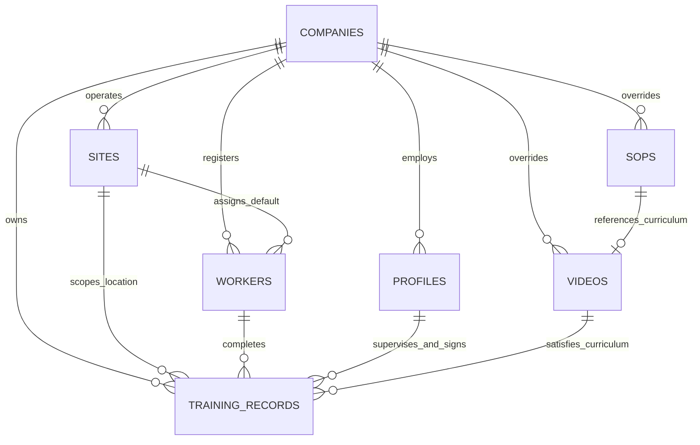
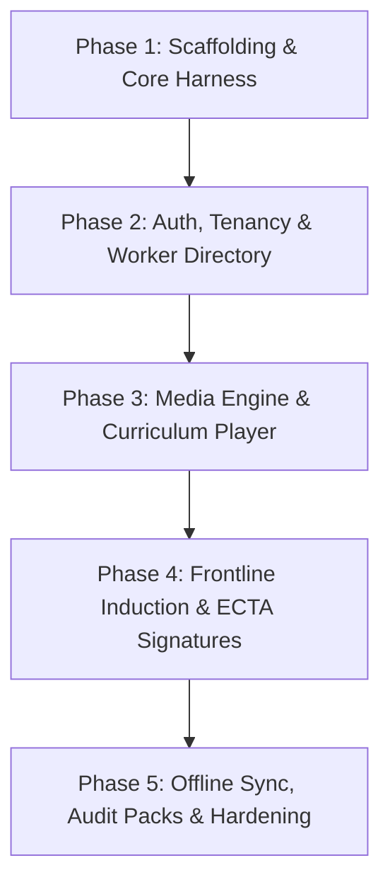

# Architectural Blueprint: The Vault Rebuild Specification
**Unified Frontline Training, Standard Operating Procedure (SOP) Governance & Statutory Compliance Engine**  
*Document Reference: `docs/vault_rebuild_blueprint.md`*  
*Role & Authority: Lead Systems Architect (`@architect`)*  
*Ecosystem Context: Simple Solutions Monorepo (`tools/vault/` & `portal/`)*  
*Status: Architecture Specification & Execution Blueprint (Pre-Implementation)*  

---

## Executive Summary & Architectural Mandate

**The Vault** represents the foundational wedge and revenue engine of the **Simple Solutions Ecosystem**. It transforms statutory industrial and agricultural compliance—traditionally characterized by lost paper sign-in sheets, unverified audit panic, and fragmented video links—into an immutable, frontline-capable digital verification spine.

This blueprint provides an exhaustive reverse-engineering specification of the legacy production implementation (`legacy/codebase/`) and details the rebuild architecture within the unified monorepo (`tools/vault/`). The target architecture eliminates monolithic frontend debt, enforces strict multi-tenant Row-Level Security (RLS), bridges to the canonical Vimeo dual-audio streaming engine (`{slug}__{language}`), integrates the migrated `vault-media` global storage hierarchy, and adopts an offline-first transactional data model.

```
+----------------------------------------------------------------------------------------------------+
|                                      THE VAULT ECOSYSTEM TARGET                                     |
+----------------------------------------------------------------------------------------------------+
|  PORTAL CONTROL PLANE (Superadmin, Estate Managers)   |  FRONTLINE FIELD SPOKE (Shift Supervisors)  |
|  • Tenant & Site Configuration                        |  • Offline-First PWA (Dexie.js Outbox)       |
|  • Statutory Worker Registry & Privacy QR Minting     |  • Camera-Based Worker QR Badge Scanning    |
|  • Consolidated Compliance Matrix & Audit Packs       |  • Dual-Audio Vimeo Player (Hot-Swapping)    |
|  • Custom SOP & Video Curriculum Overrides            |  • ECTA Sec 13 Supervisor Signature Pad      |
+----------------------------------------------------------------------------------------------------+
                                                  │
                                                  ▼
+----------------------------------------------------------------------------------------------------+
|                                    SUPABASE UNIFIED BACKEND                                        |
+----------------------------------------------------------------------------------------------------+
|  • Multi-Tenant Relational Spine: `companies`, `sites`, `workers`, `training_records`              |
|  • Global Master Curriculum: `public.videos` & `public.sops` (`company_id IS NULL` fallback)       |
|  • Storage Architecture: `vault-media/global/` (SVG Thumbnails & DOCX/PDF SOPs)                    |
|  • Edge Infrastructure: `sync_inbox` (Atomic Outbox), `audit_pack` (Zip/PDF), `paystack-webhook`   |
+----------------------------------------------------------------------------------------------------+
```

---

## 1. System Purpose & Functional Domain

### 1.1 Product Definition
The Vault is a frontline-optimized, multi-tenant Training Delivery, SOP Version Governance, and Statutory Audit Verification System engineered for high-liability commercial agriculture (macadamia, banana, citrus estates), packhouses, and heavy industrial operations. 

It satisfies rigorous social and operational certification standards—specifically **GLOBALG.A.P. IFA v6**, **SIZA Social Compliance v3**, and the South African **Occupational Health and Safety Act (Act 85 of 1993)**—without forcing frontline shift workers to create accounts or interact with administrative interfaces.

### 1.2 User Personas & Role Matrix
The platform strictly bifurcates authenticated control-plane management staff from frontline field laborers:

| Role Identifier | Authentication Method | Interface Scope | Primary Operational Responsibilities |
| :--- | :--- | :--- | :--- |
| **Superadmin (Simple Staff)** | Supabase Auth (MFA + Custom Claim `role: 'superadmin'`) | Global Portal & All Estates | Ingest global master video curriculum, audit storage buckets, oversee platform telemetry, deploy cross-tenant hotfixes. |
| **Estate Farm Manager** | Supabase Auth (JWT `company_id`, `role: 'admin'`) | Estate Dashboard & Admin Portal | Manage farm workforce directory, create site/orchard zones, review compliance percentages, initiate Paystack billing, export single-click audit packs. |
| **Shift Supervisor / Safety Rep** | Supabase Auth (JWT `company_id`, `role: 'supervisor'`) | The Vault Spoke PWA (`tools/vault/`) | Scan worker QR badges in the field, run daily toolbox talks/inductions, hot-swap bilingual video playback, sign ECTA Section 13 digital declarations. |
| **Frontline Worker / Operator** | **Unauthenticated** (Identified via Opaque `qr_token`) | Passive Field Interaction | Present physical/laminated QR badge, watch bilingual training module, acknowledge training via physical touch or supervisor verification. |

### 1.3 Core Functional Modules
1. **Privacy-Preserving Worker QR Verification**:
   - Workers carry durable QR badges containing an opaque token: `WKT-{uuid}`.
   - The token contains **zero Personally Identifiable Information (PII)** (no names, national ID numbers, or phone numbers).
   - In offline field conditions, the camera scanner parses the token and resolves worker identity against a cryptographically secured local Dexie.js cache scoped strictly to the supervisor's `company_id`.
2. **Bilingual Vimeo Video Engine & Offline Player Boundaries**:
   - Master video streams are decoupled into standardized audio variants matching the ecosystem taxonomy:
     * English & isiZulu: `{slug}__en_zu` (standard domestic operational baseline).
     * English & Afrikaans: `{slug}__en_af` (specialized variant for Western/Eastern Cape and specific technical modules).
   - Hot-swapping audio tracks preserves the playback timestamp (`getCurrentTime()`) without requiring page reloads or interrupting session momentum.
   - **PWA Physical Reality & Offline Streaming Boundary**:
     * Vimeo's player iframe requires live network bandwidth for HLS/DASH streaming, dynamic token negotiation, and DRM. The video media streams themselves **cannot and should not be cached offline** in Service Worker or IndexedDB (doing so would violate Vimeo terms and quickly exhaust local mobile storage on estate phones).
     * However, the **frontline compliance workflow is 100% offline-capable**. In remote orchards, pump houses, or packhouse muster points with poor or zero cellular signal, supervisors conduct verbal/practical SOP inductions using pre-cached SOP summaries, scan physical badges, and sign ECTA declarations offline.
3. **Controlled Standard Operating Procedure (SOP) Viewer**:
   - Master documentation catalog served directly from `vault-media/global/sops/sop_{slug}.docx` (and companion rendered PDFs).
   - Tenant-level customization allows progressive overriding: if an estate uploads custom SOP documentation (`sops.company_id = tenant_id`), the local override takes precedence over the global master template.
4. **ECTA Section 13 Digital Compliance & Signature Engine**:
   - Complies with South African Electronic Communications and Transactions Act (Act 25 of 2002) Section 13 requirements for electronic signatures.
   - Captures high-resolution canvas signature vectors, supervisor identity snapshots, worker profile snapshots, and hardware device telemetry.
   - Supports both **Individual Verification** and high-throughput **Batch Sessions** (up to 80 workers inducted in a single morning muster).
   - Fully operational in offline mode: vector coordinates and tamper-evident metadata serialize into IndexedDB immediately.
5. **Deterministic Audit Evidence & Export Engine**:
   - Real-time generation of statutory training registers.
   - Background generation of single-click audit packs organizing company profiles, worker registers, version-controlled SOPs, signed completion receipts, and incident logs into certification-ready folders.

---

## 2. Current State vs. Target Architecture Matrix

### 2.1 Technical Architecture Comparison

| Architectural Dimension | Legacy Implementation (`legacy/codebase/`) | Target Monorepo Architecture (`tools/vault/`) |
| :--- | :--- | :--- |
| **Frontend Foundation** | Multi-page static HTML (`vault.html`, `module.html`, `records.html`, `sop.html`) with inlined CDN dependencies. | Decoupled ES6 module application sharing global tokens from `packages/ui/`, adhering to monorepo standards. |
| **Component Hierarchy** | Ad-hoc HTML duplication; 1,000+ line inline script blocks per HTML file. | Reusable component modules (`PlayerWrapper.js`, `QRScanner.js`, `SignaturePad.js`, `WorkerTable.js`). |
| **Styling & Design Tokens** | Hardcoded Tailwind CDN configurations duplicated across all pages with custom CSS overrides. | Shared design tokens imported from `packages/ui/assets/css/theme.css` and shared layout engine (`portal/assets/js/layout.js`). |
| **Client State & Storage** | Ephemeral browser globals (`window.dbClient`, `window.userCompanyId`); vulnerable to script execution race conditions. | Typed, event-driven Store pattern (`VaultState.js`) utilizing `Dexie.js` (IndexedDB) for robust offline caching. |
| **Tenancy Boundary** | Soft application-layer filtering; client queries frequently checked `company_id` manually with inconsistent RLS. | Hard multi-tenant database isolation enforced via Supabase Auth JWT claims (`app_metadata -> company_id`). |
| **Curriculum Hierarchy** | Fragmented video catalog mixed with legacy tenant-branded clips; hardcoded Vimeo IDs in legacy migrations. | Clean separation: `curriculum_slug` maps to global master assets; `streams` JSON defines bilingual Vimeo IDs (`{slug}__en_zu`). |
| **Storage Asset Pipeline** | Loose bucket exports with inconsistent naming (`thumbnails/simple_solutions/`, `sops/green-farms/`). | Canonical multi-tenant bucket `vault-media`: `global/thumbnails/{slug}.svg`, `global/sops/sop_{slug}.docx`, `tenants/{company_id_uuid}/`. |
| **Worker Identity** | Legacy `company_employees` table; plain-text employee numbers; no native QR token architecture. | Unified `workers` table with opaque `qr_token` (`WKT-...`), POPIA consent flags, and site/orchard attribution. |
| **Signature & PDF Capture** | Client-side `jsPDF` executing in the browser; heavy base64 strings; browser freezes on mobile. | Lightweight vector capture in browser; asynchronous Edge Function for deterministic server-side PDF rendering. |
| **Offline Resilience** | Non-existent; loss of 2G/EDGE cellular signal results in failed API calls and abandoned attendance records. | **100% Offline-Capable Frontline Core**: While Vimeo video streaming requires live bandwidth, the worker roster, offline QR badge scanner, SOP text, and ECTA Section 13 signatures run entirely locally in IndexedDB, syncing via transactional outbox upon reconnect. |

### 2.2 Legacy Quirk & Technical Debt Catalog

```
+----------------------------------------------------------------------------------------------------+
|                                    LEGACY DEBT & QUIRK AUDIT                                       |
+----------------------------------------------------------------------------------------------------+
| 1. Race Conditions in Profile Engine (`js/profile-engine.js`):                                     |
|    • A 76KB god-script loaded on every page via `DOMContentLoaded`. Pages like `sop.html` and     |
|      `records.html` had to write polling loops (`waitForDbClient()`) to avoid reading uninitialized |
|      company variables.                                                                            |
|                                                                                                    |
| 2. Hardcoded Credentials & Client Exposure:                                                        |
|    • Live Paystack public keys (`pk_live_...`) and specific plan codes (`PLN_8n5qrpeh...`) were    |
|      hardcoded directly in client scripts (`vault.html:829`, `records.html`).                      |
|                                                                                                    |
| 3. Inconsistent Slug Normalization:                                                                |
|    • Legacy systems collapsed `fertigation_pump_house` into `irrigation_pump_house`, resulting in  |
|      overwritten thumbnails and misassigned video tracks across 4 estate catalogs.                 |
|                                                                                                    |
| 4. Client-Side PDF Memory Exhaustion:                                                              |
|    • `records.html` attempted to render multi-page attendance registers and certificates using     |
|      in-browser `jsPDF` loops (>1,000 lines), crashing mobile browsers during batch sign-offs.     |
+----------------------------------------------------------------------------------------------------+
```

---

## 3. Complete Directory & Component Blueprint

### 3.1 Target Monorepo File Structure
The rebuilt Vault application will reside cleanly within `tools/vault/` while utilizing shared assets from `packages/` and administrative routing from `portal/`:

```
tools/vault/
├── index.html                       # Vault App Shell: Catalog, Navigation, and Supervisor Dashboard
├── module.html                      # Unified Module Player & Frontline Verification Surface
├── records.html                     # Compliance Records, Attendance Registers & Worker Roster
├── sops.html                        # Controlled Standard Operating Procedures Library
├── manifest.json                    # Progressive Web App (PWA) Manifest for Mobile Install
├── service-worker.js                # Offline Caching Engine (Cache-First Assets, Network-First API)
├── docs/                            # Tool-specific documentation and compliance specifications
│   └── ARCHITECTURE.md              # Local developer and maintenance guide
└── assets/
    ├── css/
    │   └── vault.css                # Vault-specific UI enhancements (print media stylesheets, signature canvas)
    ├── js/
    │   ├── core/
    │   │   ├── config.js            # Environment resolution, Supabase anon client initialization
    │   │   ├── auth.js              # Session validation, tenant claim verification, role gating
    │   │   ├── store.js             # Reactive local store with Dexie.js IndexedDB persistence
    │   │   └── sync.js              # Transactional outbox sync engine interfacing with `sync_inbox`
    │   ├── components/
    │   │   ├── VideoPlayer.js       # Vimeo SDK wrapper with bilingual hot-swapping (`en_zu` / `en_af`)
    │   │   ├── QRScanner.js         # Camera-driven worker badge reader with local token lookup
    │   │   ├── SignaturePad.js      # ECTA Sec 13 vector signature capture & high-DPI canvas handling
    │   │   ├── SOPViewer.js         # Controlled document reader modal with tenant override detection
    │   │   ├── WorkerTable.js       # Fast virtualized worker roster with batch selection
    │   │   └── AuditPackModal.js    # Single-click certification export orchestrator
    │   └── views/
    │       ├── catalogView.js       # Master curriculum grid with category/crop-pack filtering
    │       ├── inductionView.js     # Frontline induction workflow (Watch -> Verify -> Sign)
    │       ├── rosterView.js        # Worker management, CSV batch upload, QR badge printing
    │       └── recordsView.js       # Historical training ledger, compliance stats, verification receipts
```

### 3.2 Modular Component Blueprint

#### 1. `VideoPlayer.js` (Bilingual Video Streaming Wrapper)
- **Class/Module**: `export class VideoPlayer`
- **Dependencies**: `@vimeo/player` (loaded via ESM or reliable CDN vendor bundle).
- **Core State**:
  * `vimeoPlayer`: Active Vimeo SDK player instance.
  * `canonicalSlug`: Normalized module key (e.g., `angle_grinder`, `tractor_operation`).
  * `streams`: Available stream dictionary `{ en_zu: { vimeo_id: '...' }, en_af: { vimeo_id: '...' } }`.
  * `activeLang`: Currently active audio stream key (`en_zu` default).
- **Key Methods**:
  * `mount(containerId, initialSlug, streams)`: Injects iframe with parameters `title=0&byline=0&portrait=0&badge=0&autoplay=0`.
  * `hotSwapLanguage(targetLang)`:
    1. Reads `currentTime = await player.getCurrentTime()`.
    2. Reads `isPaused = await player.getPaused()`.
    3. Executes `await player.loadVideo(streams[targetLang].vimeo_id)`.
    4. Executes `await player.setCurrentTime(currentTime)`.
    5. If `!isPaused`, calls `player.play()`.
  * `bindProgressTracker(onProgress, onComplete)`: Tracks second-by-second playback; triggers `onComplete` when playback exceeds $90\%$.

#### 2. `QRScanner.js` (Frontline Worker Token Scanner)
- **Class/Module**: `export class QRScanner`
- **Dependencies**: Native `BarcodeDetector` API with fallback to `html5-qrcode`.
- **Operating Context**: High-glare outdoor agricultural environments (orchards, tractor muster points).
- **Key Methods**:
  * `startScanning(videoElementId, onScanSuccess)`: Activates rear camera stream (`facingMode: 'environment'`); applies high-contrast focus constraints.
  * `parseToken(rawPayload)`: Validates format `WKT-[a-f0-9-]{36}`; rejects malformed or unverified QR codes.
  * `resolveWorker(token)`: Queries local `Dexie.workers` cache by `qr_token`. If found, triggers immediate worker card display; if offline and uncached, flags for post-sync reconciliation.

#### 3. `SignaturePad.js` (ECTA Section 13 Compliant Digital Signature Pad)
- **Class/Module**: `export class SignaturePad`
- **Compliance Rules**: Smooth Bezier curve capture, DPI-scaled canvas rendering, tamper-evident coordinate array serialization.
- **Key Methods**:
  * `init(canvasElement)`: Adjusts canvas resolution based on `window.devicePixelRatio`; binds touch and pointer events.
  * `clear()`: Wipes canvas buffer and resets internal point collection.
  * `isEmpty()`: Evaluates canvas pixel data to ensure minimum stroke threshold (preventing blank sign-offs).
  * `exportSignatureData()`: Exports standard PNG base64 alongside raw vector JSON metadata and timestamp.

---

## 4. Data Flow & Supabase Integration Topology

### 4.1 Master Entity-Relationship Topology
The rebuilt Vault relies strictly on the modernized relational schema defined in `.ai/SUPABASE_SCHEMA.md`:



### 4.2 Data Access Layer & Supabase Queries

#### 1. Global Master Curriculum with Tenant Overrides (`public.videos` & `public.sops`)
The data layer fetches global standard training assets while respecting tenant-specific custom assets seamlessly:

```javascript
// Fetch unified video curriculum for the active estate
export async function getCurriculumVideos(supabase, tenantCompanyId) {
  const { data, error } = await supabase
    .from('videos')
    .select(`
      id,
      curriculum_slug,
      title,
      category,
      sub_tag,
      language,
      total_seconds,
      thumbnail_url,
      description,
      objectives,
      questions,
      streams,
      company_id
    `)
    .eq('is_active', true)
    .order('title', { ascending: true });

  if (error) throw error;

  // Deduplicate: If an estate has a custom video for a curriculum_slug,
  // prioritize the tenant row over the global master row (company_id IS NULL)
  const curriculumMap = new Map();
  for (const video of data) {
    const slug = video.curriculum_slug || video.id;
    if (!curriculumMap.has(slug) || video.company_id === tenantCompanyId) {
      curriculumMap.set(slug, video);
    }
  }
  return Array.from(curriculumMap.values());
}
```

#### 2. Atomic Statutory Induction Capture (`public.training_records`)
When a shift supervisor inducts workers (individually or in batch), the transaction writes immutable snapshots of all parties to prevent audit tampering:

```javascript
// Record an immutable statutory training completion event
export async function recordTrainingCompletion(supabase, {
  companyId,
  siteId,
  workerId,
  videoId,
  supervisorId,
  workerSnapshot,      // { first_name, last_name, employee_number, id_passport_number }
  supervisorSnapshot,  // { full_name, email, role, phone_number }
  trainingType,        // 'Individual' | 'Group_Batch'
  batchSessionId,
  supervisorSignatureData,
  workerSignatureData
}) {
  const payload = {
    company_id: companyId,
    site_id: siteId || null,
    worker_id: workerId,
    video_id: videoId,
    completed_at: new Date().toISOString().split('T')[0],
    status: 'Verified',
    training_type: trainingType,
    batch_session_id: batchSessionId || null,
    supervisor_id: supervisorId,
    worker_snapshot: workerSnapshot,
    supervisor_snapshot: supervisorSnapshot,
    supervisor_signature_data: supervisorSignatureData,
    worker_signature_data: workerSignatureData || null
  };

  const { data, error } = await supabase
    .from('training_records')
    .insert(payload)
    .select()
    .single();

  if (error) throw error;
  return data;
}
```

### 4.3 Multi-Tenant Row Level Security (RLS) Verification
All database interactions are protected at the database kernel level by PostgreSQL RLS policies in `.ai/SUPABASE_SCHEMA.md`:

```sql
-- 1. SOPs: Global Master Catalog readable by all tenants; Tenant overrides restricted
CREATE POLICY sops_read_global_and_tenant ON public.sops 
FOR SELECT TO authenticated 
USING (
  (company_id IS NULL) OR 
  (company_id = (((auth.jwt() -> 'app_metadata'::text) ->> 'company_id'::text))::uuid)
);

-- 2. Videos: Global Master Curriculum readable by all; Custom videos isolated
CREATE POLICY videos_read_global_and_tenant ON public.videos 
FOR SELECT TO authenticated 
USING (
  (company_id IS NULL) OR 
  (company_id = (((auth.jwt() -> 'app_metadata'::text) ->> 'company_id'::text))::uuid)
);

-- 3. Workers: Strict Tenant Isolation
CREATE POLICY workers_tenant_all ON public.workers 
FOR ALL TO authenticated 
USING (company_id = (((auth.jwt() -> 'app_metadata'::text) ->> 'company_id'::text))::uuid)
WITH CHECK (company_id = (((auth.jwt() -> 'app_metadata'::text) ->> 'company_id'::text))::uuid);

-- 4. Training Records: Strict Tenant Isolation
CREATE POLICY training_records_tenant_isolation ON public.training_records 
FOR ALL TO authenticated 
USING (company_id = (((auth.jwt() -> 'app_metadata'::text) ->> 'company_id'::text))::uuid)
WITH CHECK (company_id = (((auth.jwt() -> 'app_metadata'::text) ->> 'company_id'::text))::uuid);
```

### 4.4 Storage Bucket Integration: `vault-media`
Migrated storage objects are organized within a single multi-tenant Supabase bucket:

```
vault-media/
├── global/                                  # Public read (authenticated users)
│   ├── thumbnails/                          # Master SVG Curriculum Icons
│   │   ├── angle_grinder.svg
│   │   ├── tractor_operation.svg
│   │   ├── fertigation_pump_house.svg
│   │   └── ... (37 canonical icons)
│   └── sops/                                # Controlled Master SOP Word & PDF Docs
│       ├── sop_angle_grinder.docx
│       ├── sop_tractor_operation.docx
│       ├── sop_fertigation_pump_house.docx
│       └── ... (37 canonical procedures)
└── tenants/                                 # Tenant-specific encrypted storage
    └── {company_id}/                        # Canonical Tenant Directory: IMMUTABLE UUIDv4
        ├── stamps/                          # Official Company Rubber Stamp scans
        ├── signatures/                      # High-res Supervisor/Worker signature assets
        ├── sops/                            # Bespoke Estate SOP overrides (sop_{slug}.docx)
        └── audit_packs/                     # Generated certification ZIP archives
```

#### Canonical Tenant Identifier Standard: UUID vs. Company Slug
To prevent directory mismatches and broken asset paths between backend services and client applications:
1. **Physical Storage Key Standard**: The tenant subfolder **strictly uses the immutable UUIDv4 string** (`companies.id`), e.g., `tenants/9f84b65c-208b-4ea7-9a91-44755f1fa023/sops/sop_bush_knife.docx`.
2. **Storage RLS Parity**: Because Supabase Auth JWT custom claims contain `company_id` as a UUID string (`(auth.jwt() -> 'app_metadata' ->> 'company_id')`), matching against the second path token `(storage.foldername(name))[2]` enforces instantaneous, zero-join security at the storage layer:
   ```sql
   CREATE POLICY tenant_storage_isolation ON storage.objects
   FOR ALL TO authenticated
   USING (
     bucket_id = 'vault-media' AND
     (storage.foldername(name))[1] = 'tenants' AND
     (storage.foldername(name))[2] = ((auth.jwt() -> 'app_metadata'::text) ->> 'company_id'::text)
   );
   ```
3. **Database Metadata Mapping**: The `sops.doc_url` column stores the canonical storage path (or signed URL). The client resolver never attempts to construct storage paths using mutable human-readable slugs (`company_slug`). Legacy bucket migration scripts (`scripts/pipe_storage_cross_project.py`) map legacy slug directories (e.g. `doveton_farm`) directly to target `{company_id}` UUID paths during asset ingestion.

---

## 5. Edge Functions, Automations & Webhooks

### 5.1 Analysis of Legacy Edge Functions
The legacy repository contained four Edge Functions (`legacy/codebase/supabase/functions/`):
1. `paystack-webhook`: Validated Paystack HMAC SHA512 signatures and captured subscription creation events. *(Migrated & active in target ecosystem)*.
2. `partner-monthly-digest`: Cron job generating 35-day tokens for corporate processors sponsoring grower packs.
3. `notify-support-ticket`: Triggered emails via Resend on new support ticket rows.
4. `notify-referral-lead`: Sent sales lead alerts when a grower entered an unsponsored crop code.

### 5.2 Target Ecosystem Edge Infrastructure
In the modernized architecture, The Vault relies on three key Edge Functions residing in `supabase/functions/`:

```
+----------------------------------------------------------------------------------------------------+
|                                    EDGE INFRASTRUCTURE SPECS                                       |
+----------------------------------------------------------------------------------------------------+
| 1. `sync_inbox` (Transactional Frontline Outbox Sync)                                              |
|    • Ingests queued array of commands from frontline Dexie.js stores.                              |
|    • Executes atomic Postgres transactions with strict client idempotency checks (`client_uuid`).  |
|    • Resolves worker QR token scans to database IDs within the caller's tenant boundary.          |
|                                                                                                    |
| 2. `generate_audit_pack` (Deterministic Certification Compiler)                                    |
|    • Ingests `{ company_id, site_id, year, audit_standard: 'GLOBALGAP' | 'SIZA' }`.                 |
|    • Generates human-readable Executive Index PDF with company profile and organogram.              |
|    • Compiles worker registers, signed ECTA Section 13 completion logs, and SOP revision lineage.   |
|    • Packages files into an encrypted, signed ZIP stream and stores it under `vault-media/tenants/`.|
|                                                                                                    |
| 3. `paystack-webhook` (Tenant Subscription & Commercial Licensing Lifecycle)                       |
|    • Verifies HMAC SHA512 signatures from Paystack.                                                |
|    • Updates `companies.billing_metadata` and manages `billing_tier` state.                        |
+----------------------------------------------------------------------------------------------------+
```

---

## 6. Phased Step-by-Step Rebuild Execution Plan

To ensure seamless system delivery without interrupting current operations, the rebuild follows a strict five-phase execution roadmap.



### Phase 1: Scaffolding, Shared Tokens & Core Shell
- **Objectives**: Establish clean file structures in `tools/vault/` and link shared styling tokens.
- **Tasks**:
  1. Create PWA application shell (`tools/vault/index.html`, `manifest.json`, `service-worker.js`).
  2. Integrate shared navigation and top bar from `portal/assets/js/layout.js`.
  3. Configure Tailwind typography, color tokens, and responsive sidebar drawer.
  4. Implement `tools/vault/assets/js/core/config.js` and initialize `dbClient` using public anon keys.
- **Exit Gate Criteria**:
  * [ ] Shell loads in under 500ms on simulated mobile 3G.
  * [ ] Sidebar and top bar navigation align with `portal/` styling standards.
  * [ ] Zero external CDN runtime dependencies beyond Supabase and Vimeo SDKs.

### Phase 2: Auth Validation, Tenant Context & Worker Directory
- **Objectives**: Implement session gating and the high-throughput worker registry.
- **Tasks**:
  1. Build `auth.js` to inspect Supabase JWT claims (`company_id`, `role`, `authorized_site_ids`).
  2. Implement `views/rosterView.js` to render and virtualize workers from `public.workers`.
  3. Build CSV import wizard with automatic column header fuzzy matching.
  4. Implement printable worker QR badge generator rendering `WKT-{uuid}` tokens.
- **Exit Gate Criteria**:
  * [ ] Unauthenticated requests cleanly redirect to `portal/index.html`.
  * [ ] Multi-tenant isolation verified: a supervisor cannot see workers from another company.
  * [ ] CSV import successfully ingests 200+ workers in a single operation.

### Phase 3: Master Curriculum & Bilingual Vimeo Player Engine
- **Objectives**: Construct the video training catalog and bilingual player interface.
- **Tasks**:
  1. Build `views/catalogView.js` querying `public.videos` and global thumbnails (`vault-media/global/thumbnails/`).
  2. Implement `components/VideoPlayer.js` wrapping the Vimeo Player SDK.
  3. Integrate the reconciled `{slug}__{language}` Vimeo catalog from `data/migration/vimeo_rename_plan.csv`.
  4. Implement audio track switcher supporting seamless hot-swapping between `en_zu` and `en_af`.
  5. Build `components/SOPViewer.js` displaying companion Word/PDF documents with tenant override resolution:
     - Read `sops` row for the active module slug.
     - If a tenant override exists (`sops.company_id = session.user.company_id`), fetch the document from `vault-media/tenants/{company_id}/sops/sop_{slug}.docx` using the tenant's primary key UUID (`company_id`), strictly avoiding mutable `company_slug` naming.
     - Fall back to `vault-media/global/sops/sop_{slug}.docx` if no custom override is present.
- **Exit Gate Criteria**:
  * [ ] Switching audio between English/Zulu and English/Afrikaans preserves playback second accurately.
  * [ ] Catalog displays 100% of the 37 canonical modules with correct SVG thumbnails.
  * [ ] Tenant SOP overrides correctly resolve via the `{company_id}` UUID path convention and take precedence over global templates.

### Phase 4: Frontline Induction & ECTA Section 13 Signature Engine
- **Objectives**: Implement the core frontline field verification and compliance capture pipeline.
- **Tasks**:
  1. Build `views/inductionView.js` integrating camera QR scanner (`components/QRScanner.js`).
  2. Implement `components/SignaturePad.js` with DPI-scaled canvas and touch vector capture.
  3. Support dual induction modes: Individual Worker Sign-off and Batch Roster Sign-off (up to 80 workers).
  4. Ensure storage paths for tenant signatures and official company stamps map strictly to `vault-media/tenants/{company_id}/signatures/` and `vault-media/tenants/{company_id}/stamps/` using the immutable tenant UUID.
  5. Write atomic transactions inserting into `public.training_records` with immutable snapshots.
- **Exit Gate Criteria**:
  * [ ] Worker QR scans reliably resolve worker records in $<300\text{ms}$.
  * [ ] Supervisor ECTA Section 13 declaration cannot be submitted with a blank signature pad.
  * [ ] Immutable snapshots (`worker_snapshot`, `supervisor_snapshot`) successfully written to database.

### Phase 5: Offline Sync, Single-Click Audit Packs & Production Polish
- **Objectives**: Enable robust frontline offline capability and automated certification audit pack exports.
- **Offline Player Boundaries (PWA Reality)**:
  * **Vimeo Video Streaming Boundary**: High-definition video streams delivered via Vimeo's player iframe require live network bandwidth (due to dynamic token authentication, adaptive HLS/DASH streaming, and DRM constraints). Video byte streams **cannot and should not be cached offline** in Service Worker or IndexedDB (doing so violates Vimeo licensing and would quickly exhaust local mobile storage on agricultural devices).
  * **100% Offline-Capable Frontline Induction Core**: The frontline statutory compliance workflow is fully decoupled from video playback:
    1. *Pre-Cached Master Data*: Worker rosters (`Dexie.workers`), active SOP text/summaries, comprehension questions, and supervisor declarations are cached locally in IndexedDB upon login.
    2. *Field Badge Scanning*: Camera-based QR badge reader (`components/QRScanner.js`) resolves worker tokens (`WKT-{uuid}`) against local IndexedDB in $<300\text{ms}$ with zero network calls.
    3. *Practical / Manual Field Training*: When operating in remote orchards or pump stations with zero signal, supervisors conduct practical/verbal SOP inductions and review pre-cached SOP checklist criteria.
    4. *Offline ECTA Section 13 Signatures*: The supervisor and workers execute digital signatures on the mobile canvas (`components/SignaturePad.js`), serializing raw vector coordinates into local storage.
    5. *Atomic Transactional Outbox*: The completed induction record receives a client-side UUIDv4 (`client_uuid`), is queued in `Dexie.outbox`, and remains safe from app termination or reboots.
    6. *Automatic Background Sync*: As soon as the mobile device reconnects to 4G/LTE or farm office Wi-Fi, the sync engine pushes queued records to the `sync_inbox` Edge Function, writing server-confirmed database rows with zero duplicates.
- **Tasks**:
  1. Implement client-side `Dexie.js` transactional outbox in `core/store.js` and `core/sync.js`.
  2. Configure service worker caching for application shell, styles, SOP text, and worker rosters (explicitly omitting Vimeo video streams).
  3. Implement graceful offline video fallback badge in player UI ('Video streaming offline — Proceed with practical/manual field SOP induction').
  4. Implement `components/AuditPackModal.js` invoking the `generate_audit_pack` Edge Function.
  5. Build historical training records ledger with filtering by worker, site, date, and certification standard.
  6. Perform complete end-to-end security audit and multi-tenant penetration verification.
- **Exit Gate Criteria**:
  * [ ] Supervisor can conduct complete inductions in simulated airplane mode (offline): badge scan, verbal SOP review, and ECTA Section 13 signature execute smoothly and queue in IndexedDB.
  * [ ] Reconnection pushes queued records to `sync_inbox` automatically, creating immutable `training_records` with zero data loss or duplicate rows.
  * [ ] Video player displays a graceful offline notice without crashing or hanging the app shell when disconnected.
  * [ ] Generated certification audit pack produces a valid, standardized directory structure and index PDF.
  * [ ] Codebase audited and wrapped up via `agy --agent closer`.

---

## Architectural Sign-Off & Verification

This specification stands as the authoritative architectural blueprint for rebuilding The Vault within the Simple Solutions Ecosystem. All downstream implementation steps must strictly adhere to the schemas, component interfaces, and multi-tenant isolation boundaries documented herein.

*Lead Systems Architect Signature:* `@architect`  
*Timestamp:* 2026-10-17T12:58:00+02:00  
*Ecosystem Monorepo Context:* `/home/luca/dev/simple-solutions-ecosystem`
